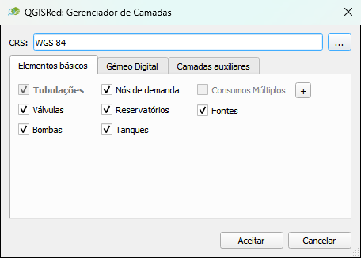
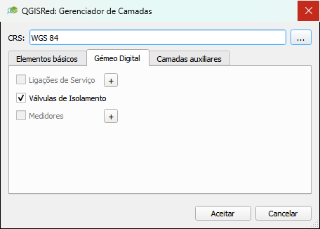
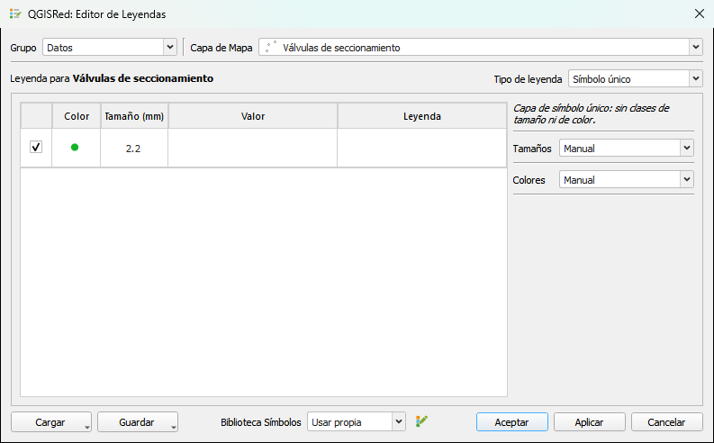

# Layer Manager and Legend

---

## Layer Manager

**Project bar → Layer manager** (Layer manager)

Controls which project layers are active in QGIS, allows you to recreate missing base elements, and manages the auxiliary layers of the Nodal demand builder. The dialog organizes its content into three tabs: **Basic elements**, **Digital Twin** and **Auxiliary layers**.

<figure><figcaption><p>QGISRed Layer Manager Dialog</p></figcaption></figure>
<!-- TODO: Capture outdated, dialog moved from stacked sections to tabs (see commits 12d9ee7 and 11c29ed) -->
*Layer manager: list of all the layers in the project with their loading status.*

Above the tabs the **CRS** field is always visible, with the project coordinate system and a **...** button to change it.

### Basic elements and Digital Twin tabs

- **Basic elements** brings together the 6 base elements of EPANET (Pipes, Junctions, Tanks, Reservoirs, Valves, Pumps) plus the complementary layers Multiple Demands and Sources.
- **Digital Twin** brings together the layers of the digital twin: Service Connections, Isolation Valves and Meters.

For each element, the row shows one of two things depending on whether or not its file exists on disk:

- **Box checked/unchecked** → the shapefile already exists; The checkbox decides if the layer is loaded and visible in QGIS. You can check or uncheck any without affecting the data.
- **Button "Create `<Elemento>` Layer"** → the shapefile does not exist yet; the button creates it empty (with the correct field structure) and opens it automatically. Once created, the row now displays the box.

> ⚠️ Pipes is the exception: as soon as she is loaded, her box is locked. It is the layer that holds the rest of the network, so it cannot be downloaded from here without first downloading the rest of the project.

> 💡 When you press **Accept**, the dialog only acts on what has changed: an element that was already marked and remains marked is not closed and reopened, so it preserves its style, its visibility and the selection you had made on the canvas. Changing the CRS is the exception — as it rewrites all shapefiles, it closes and reopens everything managed by the dialog.

### Recover a deleted layer

If you have accidentally deleted a layer from the QGIS legend (or its SHP file on disk), the Layer Manager allows you to **recreate it empty**: when you open the dialog, that layer no longer shows the checked box, but rather the **Create `<Elemento>` Layer** button described above. Hit it and QGISRed creates the empty SHP with the correct field structure and loads it into QGIS.

> ⚠️ The recreation creates the empty layer. The data that was on it (if the SHP was erased from the disk) cannot be recovered unless you have a backup copy.

### Outdated Layer Notice

In addition to the deleted layer warning icon, the QGIS legend can display a second type of warning icon (⚠) on layers that **do exist** but whose content may have become obsolete.

QGISRed monitors in the background (checking every 5 seconds) the derived layers hanging from the project folders **Issues**, **Queries** and **Results**, whose file name begins with `<Red>_`. If the network's most recent input file (Pipes, Junctions, etc.) has been modified after one of those derived layers was generated, that layer receives the warning icon with the message:

> "Layer may be outdated — inputs have changed since last generation"

- The icon is for informational purposes only: it does not have any action associated with clicking on it.
- To resolve the warning you must **regenerate the layer**, that is, re-launch the analysis or the query that created it (Isolated Segments, Hydraulic Sectors, a property query, etc.).
- The auxiliary layers of the Nodal demand builder (Consumption Points, Demand Links, Demand Sectors) are explicitly excluded from this surveillance: they are your own data that you import or create, not something that QGISRed recalculates from the network, so editing an input does not invalidate them.

> 💡 This notice is different from the icon that appears when a layer has been deleted (see "Recover a deleted layer" above): here the layer still exists and is loaded, its content may simply no longer reflect the current state of the network.

### Auxiliary layers tab: Nodal demand builder layers

The **Auxiliary layers** tab contains the **Demand Builder** group, from where the empty work layers used by the tool for assigning demands to nodes (Nodal demand builder) are created and managed: **Consumption Points**, **Demand Links** and **Demand Sectors**.

<figure><figcaption><p>Auxiliary layers tab of the QGISRed Layer Manager</p></figcaption></figure>

Each row in the table is a **theme** (theme) — you can have several themes of the same type, for example a different `Sectors` for each demand sectoring campaign. The table shows three columns:

- Upload box (same as the other tabs: checked = uploaded to QGIS).
- **Theme** — name of the theme, or "(default)" for the one the Nodal demand builder itself automatically creates.
- **Type** — Consumption Points / Demand Links / Demand Sectors.

To create a new topic:

1. Press **Create Auxiliary Theme**.
2. In the **New auxiliary theme** dialog, choose the **Type** (Consumption Points, Demand Links or Demand Sectors) and type a **Name**.
3. Press **Accept**. QGISRed creates the empty shapefile with the corresponding fields and adds it already marked and loaded to the table.

To delete a theme, select its row and press **Delete Auxiliary Theme**; You will be asked for confirmation because the operation also deletes the files on the disk.

When you select a **Consumption Points** theme, a **…** button also appears (tooltip "Base demand fields") that opens the **Base demand fields** dialog, where the theme's base demand columns are managed (every field after `DemID` and `Category`):

- The list shows one field per row, with the name editable directly (double-click or keyboard).
- **+** adds a new row with a suggested free name (`BaseDem`, `BaseDem2`…); **-** deletes the selected row. The theme always needs at least one base demand field.
- When you press **Accept**, QGISRed validates the names: they cannot be empty, cannot exceed 10 characters (DBF format limit), must start with a letter and contain only letters, numbers and underscores, and no two fields can share the same name (case-insensitive). If something is not valid, the dialog does not close and shows the reason.
- If an existing field has been removed from the list, applying the changes asks for explicit confirmation because its values are deleted too; renaming a field, on the other hand, keeps the data.

> 💡 The layers that you leave marked in this table are remembered when closing and reopening the project — including projects that do not save a `.qgz` — just like the rest of the layers in the project.

> To know how these layers are used within the Nodal demand builder (import consumption points, generate demand links, aggregate by sectors...), see [Demands and scenarios](../tools/demands-and-scenarios.md).

### Model Summary (Summary)

**Project bar → Summary**

Generate a quick report with the number of elements of each type present in the project:

```
Junctions: 1 243
Pipes: 1 876
Tanks: 3
Reservoirs: 2
Valves: 47
Pumps: 8
```

Useful to verify that the import was complete or to document the size of the model.

---

## Legend Editor

**Project bar → Legend editor** (Legend editor)

Opens a floating panel that allows you to build and customize the **symbology** of the project layers without navigating through the QGIS layer properties menu: legend type, automatic classification, sizes, colors, opacity and border on polygon layers, its own ramp/palette library, saving/loading styles and own rules per element type.

<figure><figcaption><p>QGISRed Legend Editor Panel</p></figcaption></figure>
<!-- TODO: screenshot outdated, dialog completely redesigned and has kept changing since then (block of [Legends]/[Styles] commits, Sep-Oct 2026) -->
*Legend Editor panel: predefined styles and customization of colors and sizes.*

### Choose layer

In the dialog header:

- **Group** — group of the layer tree on which you want to work (Inputs, Results, Queries and their subgroups...).
- **Map Layer** — specific layer within that group. You can also change layers by selecting it directly in the QGIS layers panel; the editor follows the selection automatically.

### Variant selector

Several input layers show an additional dropdown that filters the table and the color/size/opacity rules to a subset of the layer instead of all its elements at once:

| Layer | Dropdown | Options |
|---|---|---|
| Meters | **Meter Type** | "All types" or a specific meter type (the different icons stacked in the symbol) |
| Junctions | **Demand** | "All", "Outflows (> 0)", "Inflows (< 0)" |
| Sources | **Source Type** | "All types" or a specific source type |
| Service Connections | **Component** | "All", "Line", "Demand circle" |
| Link layers (Pipes and similar) | **Component** | "All", "Line", "Marker" |
| Connectivity tree nodes (Tree) | **Node** | "All", "Junctions", "Root node" |
| Layers with their own element types | **Element** | "All" + one type for each possible element of that layer |

While the selector is set to "All" (or has no variants), the color/size is applied to all elements at once, unless the layer has fixed style rules (see below).

### Legend type and classification

The **Legend Type** dropdown offers, depending on the type of layer, between **Single Symbol**, **Categorized** and **Graduated**. Only the options that make sense for that layer appear (for example, a numeric results layer does not offer Single Symbol); if the layer is Single Symbol with no classes, the panel shows the warning "Single symbol layer: no size or color classes."

The central table lists one row per class, with visibility checkbox, color, size, value/range (or category), and legend label:

- **Classes** is only editable when the classification mode supports a variable number of classes (for example, not in Manual mode on a numeric legend nor on layers with a fixed legend); in the rest of cases it appears grayed out, with no arrows, and cannot be typed into. The button next to it, **Add all values** (formerly "Classify All"), adds a class for each unique value of the layer (categorical) or automatically reclassifies the numerical range according to the mode chosen in **Intervals**.
- The **+** button next to Classes adds a class below the selection with a single click; the arrow next to it opens a menu with "Add class above the selection" and, on categorical legends, 'Add "Other values" class' (a special class that groups the rest of the unclassified values). The **-** button removes the selected class.
- **Intervals** (`cbMode`) sets the automatic classification method for graduated legends: Manual, Equal Interval, Fixed Interval, Quantile (Equal Count), Natural Breaks (Jenks), Standard Deviation and Pretty Breaks. With **Fixed Interval** the **Interval Range** field appears to indicate the width of each class.
- You can edit the range of a class by hand by **double clicking on its value** (Value column) to open a small dialog with the lower and upper limits.
- **Up / Down** (arrows next to the table) manually reorder the selected class. The **Class Order** dropdown (None / Ascending / Descending), above the table, automatically reorders all classes by their value at the moment the legend is applied.

### Sizes

The **Sizes** block controls the size of the classes, always in millimeters except for the exception below:

- **Sizes** (`cbSizes`): Manual, Equal, Linear, Quadratic, Exponential or Proportional to Value.
- **Equal** uses a single **Value** field for all classes.
- Linear/Quadratic/Exponential/Proportional to Value distribute the size between **Min** and **Max** according to the chosen curve, with the **Invert** box to exchange which end (lower or higher value) receives the minimum size.

> 💡 On layers with a fixed status legend (see "Specific style rules" below) or on a Single Symbol layer with the variant selector set to "All", the column header changes to **Size (%)**: the value is no longer a size in mm but a **percentage of the current sizes** — 100% leaves each element with the size it already has drawn, and the adjustment scales all of them at once instead of setting an absolute size per class.

### Colors

The **Colors** block controls the color of each class. The **Colors** dropdown (`cbColors`) offers, in addition to Manual/Equal/Random, the library's ramps and palettes grouped by type:

- **Manual** — each class keeps the color it has been set to by hand.
- **Equal** — a single color (color button next to the dropdown) for all classes.
- **Random** — different random colors per class, with the same "shuffled random colors" criterion that QGIS uses natively. The refresh button next to the dropdown (visible only in this mode) reshuffles the colors without changing anything else.
- **2 colors Ramps / 3 colors Ramps / > 3 colors Ramps** — continuous color ramps, grouped by how many colors define the ramp.
- **Span Palettes** — categorical palette whose colors are spread across the range of classes, keeping the first and last.
- **Sequential Palettes** — categorical palette whose colors are assigned in the order they are declared in the palette.
- **Labeled Palettes** — categorical palette where each class receives the color whose label matches its own value.

The editor itself **recommends an option** based on the legend type (Span Palettes for numeric legends; Labeled Palettes if there is a labeled palette that matches the layer's categories, or Sequential Palettes in any other categorical case): that option appears in bold with the suffix "(recommended)". Options with no ramp/palette of that type in the active library, or Labeled Palettes on a numeric legend, appear disabled with a tooltip explaining why.

The **Invert** box exchanges the direction of the chosen ramp/palette.

> 💡 For the connectivity tree node layer (Tree), the row color does not color the entire symbol: it edits only the **stroke color** of the outer circle of the node, leaving the star and element icons with their own color.

### Ramp and palette library

Next to the Colors dropdown, **Symbol library** lets you choose where the ramps and palettes offered by that dropdown come from:

- **Use default** — the library that ships with QGISRed out of the box.
- **Use owner** — your own editable library. Selecting it shows the **Edit owner** button, which opens QGIS's native style manager (Style Manager) on that library to add, edit or delete ramps, palettes and symbols. Changes you make there are reflected immediately in the Colors dropdown, even recalculating already-applied colors if the active ramp changed.

### Opacity and border (fill layers)

On layers whose symbol is a polygon fill (for example, Hydraulic and Demand Sectors), the panel adds two controls that apply **to all classes at once**, not class by class:

- **Opacity** (0–100%) — fill opacity; 100% is solid, 0% invisible.
- **Border** — border mode for each class: "No border", "Black", "Fill color" (the border takes the same color as the fill) or "Darker than the fill"; with any option except "No border" the border width in mm also appears.

### Specific style rules per layer type

Input elements (Inputs) and some query layers carry style rules with fixed states that the color/size you choose respects, instead of overriding the entire symbol. For example, Pipes/Valves/Pumps keep the "closed" state in red and active Valves in orange no matter what happens with the color you choose for the rest. Among the layers with their own rules:

- **Multiple Demands**: the chosen color only colors the "positive demand" branch of the symbol (the inner marker), just like in Junctions; the negative demand and the rest of the symbol maintain their fixed colors.
- **Junctions**: with the **Demand** selector set to "Outflows (> 0)" or "Inflows (< 0)" you can classify and color each group of nodes separately; negative demands always keep white in automatic range-based legends.
- **Isolation Valves**: the chosen color only replaces the "open, no pressure loss" state; The colors of closed (red), with loss of charge (amber) and not available (gray) are set by the legend itself and cannot be edited from here.
- **Meters**: The color and size are applied depending on what you have selected in **Meter Type** — to all meter types at once, or only to the chosen type, without touching the rest of the stacked icons.
- **Service Connections**: the chosen color is applied to the active connection stroke and to a lighter version of the same color for its fill; The rest of the states retain their own color.
- **Connect_Links** (result of the Connectivity tool, within Queries): unlike the previous ones, it does not have rules by state — the color and size are applied directly to the symbol, as in any Single Symbol layer.

### Load and save styles

The **Load** and **Save** buttons, at the bottom of the dialog, each open a menu:

**Load**
- **Default Style** — retrieves the default QGISRed style for that layer type.
- **Global Style** — load a style that you have previously saved at a global level (valid for any project).
- **Project Style** — loads a style saved within this project.
- **Revert to Original Legend** — recovers in the dialog the legend that the layer had at the time of opening the editor (without the need to close and reopen the dialog).

**Save**
- **To Global...** — saves the current legend as a global style, reusable in any project.
- **To Project...** — saves the current legend inside the `layerStyles` folder of this project.

When saving, a small dialog lets you choose whether you want to save the legend **as seen** or a **strategy** that regenerates automatically the next time you load it (by marking which parts to keep: the class/range structure, the sizes and/or the colors).

> ⚠️ Both **Load** and **Revert to Original Legend** only update the dialogue preview. The project layer doesn't change until you press **Apply** or **Accept**.

### Apply, Accept and Cancel

The bottom three buttons have very specific preview semantics:

- **Apply** — applies the changes shown in the dialog to the layer, without closing the editor. Useful to see the result on the canvas while you continue adjusting.
- **Accept** — applies the changes to the layer and closes the dialog (equivalent to Apply + close).
- **Cancel** — closes the dialog and **restores the layer to the legend it had when you selected it** in this editor, also undoing any changes you may have already applied with Apply. If there were changes applied, QGISRed asks for confirmation before discarding them.

> 💡 Since Cancel always returns you to the starting state (even if you've pressed Apply several times while trying things out), it's the safe way to "start over" with a layer without having to rebuild its legend by hand.
