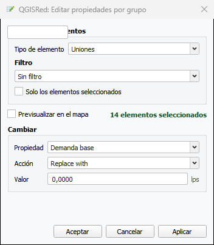

# Edición por Grupo

**Barra Edición → Editar propiedades por grupo…**

La herramienta **Edit properties by group** permite modificar en bloque un atributo de múltiples elementos de la red. Combina un filtro opcional con una acción de edición y aplica el resultado a todos los elementos que cumplen la condición, acumulando los cambios en un buffer de edición de QGIS hasta que el usuario los confirma o descarta.

El diálogo es **no modal**: se puede seguir interactuando con el mapa mientras está abierto.

<figure><figcaption>
Diálogo Edit properties by group con filtro y acción configurados
</figcaption></figure>
*Diálogo de edición por grupo: filtro por campo numérico y acción Multiply by sobre tuberías.*

---

## Tipos de elementos disponibles

| Elemento | Descripción |
|----------|-------------|
| **Uniones** | Nudos de la red |
| **Demandas múltiples** | Demandas múltiples por categoría |
| **Tuberías** | Tuberías |
| **Depósitos** | Depósitos |
| **Embalses** | Embalses |
| **Bombas** | Bombas |
| **Válvulas** | Válvulas |
| **Fuentes** | Fuentes de calidad |
| **Acometidas** | Acometidas |
| **Válvulas de seccionamiento** | Válvulas de aislamiento |
| **Medidores** | Caudalímetros |

> 🧪 **Campos de calidad química:** Los campos BulkCoeff y WallCoeff (tuberías) y ReactCoef e InitQuality (depósitos, embalses y nudos) solo aparecen en los selectores de campo cuando el modelo de calidad del proyecto está configurado como **Químico**.

---

## Seleccionar elementos

La sección **Seleccionar elementos** del diálogo agrupa el filtro de campo, la previsualización en el mapa y el ámbito de aplicación.

### Filtro de campo

El desplegable de campo comienza con la opción **Sin filtro** (*No Filter*). Mientras se mantiene esa selección, los controles de operador y valor permanecen ocultos y la acción afecta a todos los elementos del tipo elegido.

Al seleccionar un campo concreto, aparecen los controles de operador y valor:

- El **operador** determina el tipo de comparación (véase tabla más abajo).
- El **valor** se rellena automáticamente con los valores únicos presentes en la capa. La lista incluye **NULO** como primera opción:
  - Operador `=` con NULL genera un filtro **IS NULL**.
  - Operador `≠` con NULL genera un filtro **IS NOT NULL**.
- El campo de valor dispone de un botón **×** para borrarlo rápidamente. Además, el campo es **editable**: el usuario puede escribir un valor personalizado que no figure en la lista desplegable.

#### Operadores disponibles por tipo de campo

| Tipo de campo | Operadores |
|---------------|------------|
| Numérico | `>=`, `<=`, `=`, `>`, `<`, `≠` |
| Lista de valores | `=` |
| Texto libre | `=`, `≠`, `ILIKE`, `NOT ILIKE`, `LIKE`, `NOT LIKE` |
| Fecha | `=` (selector de calendario) |

### Preview en el mapa

El checkbox **Vista previa en el mapa** resalta en **naranja** los elementos que cumplen el filtro activo, actualizándose en tiempo real al cambiar cualquier parámetro del filtro. Junto a este checkbox se muestra el **número de elementos** que coinciden con el filtro en ese momento.

### Solo elementos seleccionados

Al marcar **Solo los elementos seleccionados**, la acción afecta únicamente a los elementos que estén seleccionados en el mapa en el momento de pulsar **Aplicar**. La selección puede realizarse antes de abrir el diálogo o mientras está abierto.

Sin marcar (por defecto), la acción se aplica a todos los elementos del tipo elegido que cumplan el filtro.

---

## Acción de edición (sección "Do…")

Define qué atributo modificar y con qué valor o transformación.

### Acciones para campos numéricos

| Acción | Fórmula |
|--------|---------|
| **Reemplazar por** | `operando` |
| **Multiply by** | `valor_actual × operando` |
| **Añadir** | `valor_actual + operando` |
| **Restar** | `valor_actual − operando` |
| **Divide by** | `valor_actual / operando` |
| **Clamp minimum to** | `max(valor_actual, operando)` |
| **Clamp maximum to** | `min(valor_actual, operando)` |

### Acciones para campos de texto

| Acción | Resultado |
|--------|-----------|
| **Set to** | Reemplaza el valor completo |
| **Prepend** | Antepone el texto al valor actual |
| **Append** | Añade el texto al final del valor actual |
| **Find and replace** | Búsqueda y reemplazo (distingue mayúsculas) |

### Acciones para campos enumerados

Solo **Reemplazar por**, seleccionando el nuevo valor de una lista. Las opciones disponibles dependen del tipo de campo:

| Campo | Fuente de opciones |
|-------|--------------------|
| `InitStatus` | Lista fija de EPANET (Open, Closed, CV, Active…) |
| `Material` | Tabla de materiales del proyecto |
| `Curve` | Curvas del proyecto filtradas por tipo (pump, volume, efficiency, headloss) |
| `Pattern` | Patrones del proyecto filtrados por tipo (demand, quality, head, speed, price) |
| `ValveType` (solo Valves) | Lista fija de EPANET (PRV, PSV, PBV, FCV, TCV, GPV), mostrada en el combo con su nombre largo en español (p. ej. "Reductora de Presión" para PRV) |

### Campos de fecha

Acción **Set to**: la fecha se selecciona desde el combo de fechas existentes en la capa o mediante el botón de calendario.

---

## Botones del diálogo

| Botón | Comportamiento |
|-------|----------------|
| **Aplicar** | Muestra un diálogo de confirmación previo que detalla los cambios que se aplicarán temporalmente (tipo de elemento, campo y número de elementos afectados) y solicita confirmación antes de escribir al buffer de edición de QGIS. Puede llamarse varias veces para acumular cambios sobre distintos atributos. Los elementos modificados quedan seleccionados en el mapa y su tabla de atributos se abre o reactiva. |
| **Aceptar** | Muestra una confirmación simple y, tras aceptar, guarda en disco de forma permanente todos los cambios acumulados en el buffer. Cierra el diálogo; las tablas de atributos permanecen abiertas. |
| **Cancelar** | Descarta **todos** los cambios acumulados en el buffer (rollback completo) y cierra el diálogo. Limpia la selección en el mapa, pero las tablas de atributos permanecen abiertas. |

> Los cambios solo se escriben a disco al pulsar **Aceptar**. Mientras se trabaja con **Aplicar**, los datos están en el buffer de edición de QGIS y pueden deshacerse en bloque con **Cancelar** en cualquier momento.

---

## Tabla de atributos

Tras cada **Aplicar**, la herramienta abre o reactiva la tabla de atributos de la capa afectada —tanto si está acoplada como si está flotante— sin duplicarla. Los elementos modificados aparecen ordenados al principio. Si se editan varias capas en sucesivos **Aplicar**, cada tabla se gestiona de forma independiente.

Al pulsar **Cancelar** o **Aceptar**, las tablas de atributos permanecen abiertas; únicamente se limpia la selección en el mapa.

---

## Actualización automática del diálogo

Cuando se añaden o eliminan capas mientras el diálogo está abierto, este se actualiza automáticamente y restaura las selecciones previas de tipo de elemento, campo y filtro. Si el proyecto se cierra o se carga un proyecto diferente, el diálogo se cierra de forma automática.

---

## Ejemplos de uso

**Cambiar material a tuberías de un diámetro concreto**
Elemento: Pipes — Filtro: `Diameter = 200` — Do: `Material → Replace with → PVC`

**Incrementar el 10 % la rugosidad de tuberías de fundición**
Filtro: `Material = FD` — Do: `Roughness → Multiply by → 1.1`

**Cerrar todas las válvulas de aislamiento**
Elemento: Isolation Valves — Filtro: Sin filtro — Do: `InitStatus → Replace with → CLOSED`

**Asignar patrón a un conjunto de nudos seleccionados**
Marcar "Solo los elementos seleccionados" — Elemento: Junctions — Do: `Pattern → Replace with → PAT_RESIDENCIAL`

**Reemplazar texto en etiquetas**
Elemento: Junctions — Do: `Tag → Find and replace → Buscar: "SEC" / Reemplazar: "ZN"`
