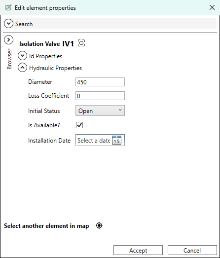

# Propiedades de Elementos

**Barra Edición → Editar propiedades de los elementos…**

El diálogo de propiedades es la herramienta central para ver y editar todos los atributos de cualquier elemento de la red. Funciona como un formulario inteligente que carga los datos del elemento pulsado y permite navegar entre elementos sin cerrarlo.

<figure><figcaption>
Diálogo de propiedades de una tubería con todos sus campos
</figcaption></figure>
*Diálogo de propiedades: atributos del elemento, navegador de elementos conectados y botón de centrado.*

---

## Cómo abrir el diálogo

1. Activa la herramienta pulsando el botón **Edit element properties…** (icono de lápiz/editar).
2. Haz clic sobre cualquier elemento de la red en el mapa: tubería, nudo, válvula, bomba, depósito o embalse.
3. El diálogo se abre mostrando todos los atributos del elemento seleccionado.

> La herramienta permanece activa mientras el botón esté pulsado. Puedes ir haciendo clic sobre diferentes elementos sin volver a activarla.

---

## Campos de las tuberías (Pipes)

| Campo | Descripción |
|-------|-------------|
| **ID** | Identificador único de la tubería |
| **Longitud** | Longitud calculada automáticamente a partir de la geometría (m o ft) |
| **Diámetro** | Diámetro interior (mm o pulgadas) |
| **Coef. Rugosidad** | Rugosidad para la fórmula de pérdida de carga configurada |
| **MinorLoss** | Coeficiente de pérdidas menores (0 si no aplica) |
| **InitStatus** | Estado inicial: Open, Closed o CV (Check Valve) |
| **Material** | Código del material (referenciado en la Tabla de materiales) |
| **InstallYear** | Año de instalación (formato `YYYY`), usado para calcular la rugosidad por envejecimiento |
| **BulkCoeff** | Coeficiente de reacción en masa (para modelos de calidad de tipo Chemical) |
| **WallCoeff** | Coeficiente de reacción en pared (para modelos de calidad de tipo Chemical) |

---

## Campos de los nudos (Junctions)

| Campo | Descripción |
|-------|-------------|
| **ID** | Identificador único del nudo |
| **Cota** | Cota del nudo (m o ft) |
| **Demanda** | Demanda base (en las unidades de caudal del proyecto) |
| **Pattern** | ID del patrón de demanda aplicado |
| **EmitterCoeff** | Coeficiente de emisor (para modelar fugas dependientes de presión) |
| **InitQuality** | Concentración o edad del agua inicial (solo si el modelo de calidad está activo) |

### Demandas múltiples

Los nudos pueden tener más de una demanda (categorías de usuario: residencial, industrial, etc.). Si el proyecto tiene la capa opcional `{Red}_MultipleDemands.shp`, el diálogo muestra un apartado adicional donde puedes añadir, editar y eliminar demandas por categoría:

| Campo | Descripción |
|-------|-------------|
| **Demanda** | Valor de demanda para esta categoría |
| **Pattern** | Patrón de demanda específico de la categoría |
| **Nombre** | Etiqueta de la categoría (informativa) |

---

## Campos de los depósitos (Tanks)

| Campo | Descripción |
|-------|-------------|
| **ID** | Identificador único |
| **Cota** | Cota del fondo del depósito |
| **InitLevel** | Nivel inicial del agua sobre el fondo |
| **MinLevel** | Nivel mínimo operativo |
| **MaxLevel** | Nivel máximo operativo |
| **Diámetro** | Diámetro del depósito (0 si usa curva de volumen) |
| **MinVol** | Volumen mínimo (m³) |
| **VolCurve** | ID de la curva de volumen (para geometría no cilíndrica) |
| **MixModel** | Modelo de mezcla: MIXED, 2COMP, FIFO, LIFO. Por defecto, MIXED en un depósito nuevo |
| **MixFraction** | Fracción del primer compartimento (solo visible si MixModel = 2COMP) |

> Ambos campos solo se muestran si el proyecto tiene activo un modelo de calidad (Chemical, Age o Trace); sin modelo de calidad, EPANET no mezcla nada y los campos no aportan información.

---

## Campos de los embalses (Reservoirs)

| Campo | Descripción |
|-------|-------------|
| **ID** | Identificador único |
| **Altura** | Carga piezométrica fija (m o ft) |
| **Pattern** | Patrón de variación de carga a lo largo del tiempo |

---

## Campos de las válvulas (Valves)

| Campo | Descripción |
|-------|-------------|
| **ID** | Identificador único |
| **Diámetro** | Diámetro (mm o pulgadas) |
| **Tipo de válvula** | Tipo de válvula: PRV, PSV, PBV, FCV, TCV, GPV |
| **Consigna** | Consigna de regulación (presión, caudal o pérdida de carga según el tipo) |
| **MinorLoss** | Coeficiente de pérdidas menores |
| **InitStatus** | Estado inicial: Open, Closed, Active |

---

## Campos de las bombas (Pumps)

| Campo | Descripción |
|-------|-------------|
| **ID** | Identificador único |
| **Curve** | ID de la curva H-Q de la bomba |
| **Velocidad** | Factor de velocidad de giro (1.0 = nominal) |
| **Pattern** | Patrón de variación de velocidad |
| **Potencia** | Potencia constante (alternativa a la curva H-Q) |
| **EfficiencyCurve** | ID de la curva de eficiencia (para análisis de energía) |
| **EnergyPrice** | Precio de la energía específico para esta bomba |
| **PricePattern** | Patrón de variación de precio de energía |
| **InitStatus** | Estado inicial: Open o Closed |

---

## Navegación entre elementos

El diálogo incluye un **navegador** (Browser) que permite:

- **Ir a elemento conectado**: lista los nudos y elementos conectados al elemento actual para saltar a ellos. En una tubería/válvula/bomba se listan sus dos nudos extremos; en un nudo, las líneas que llegan a él. En ambos casos se añaden válvulas de aislamiento, contadores y acometidas, pero solo si su ubicación coincide con el elemento (dentro de la tolerancia de nudo del proyecto) — no basta con estar simplemente cerca.
- **Historial**: botones Anterior / Siguiente para volver a elementos visitados anteriormente sin cerrar el diálogo.
- **Centrar en mapa**: botón para desplazar el mapa al elemento actualmente mostrado.

> Al navegar a otro elemento desde el diálogo, QGISRed guarda los cambios del elemento anterior antes de cargar el nuevo. No es necesario pulsar "Aceptar" explícitamente tras cada modificación.

---

## Campos exclusivos de QGISRed

Estos campos no forman parte del estándar EPANET pero son usados por el plugin:

| Campo | Capa | Descripción |
|-------|------|-------------|
| **Material** | Pipes | Código de material referenciado en la Tabla de materiales |
| **InstallYear** | Pipes | Año de instalación para cálculo de rugosidad por envejecimiento |
| **Activa** | Varios | Habilita/deshabilita el elemento en el Gemelo Digital |
| **Etiqueta** | Todos | Etiqueta libre (equivalente al campo TAG de EPANET) |
