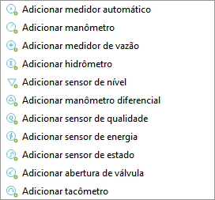
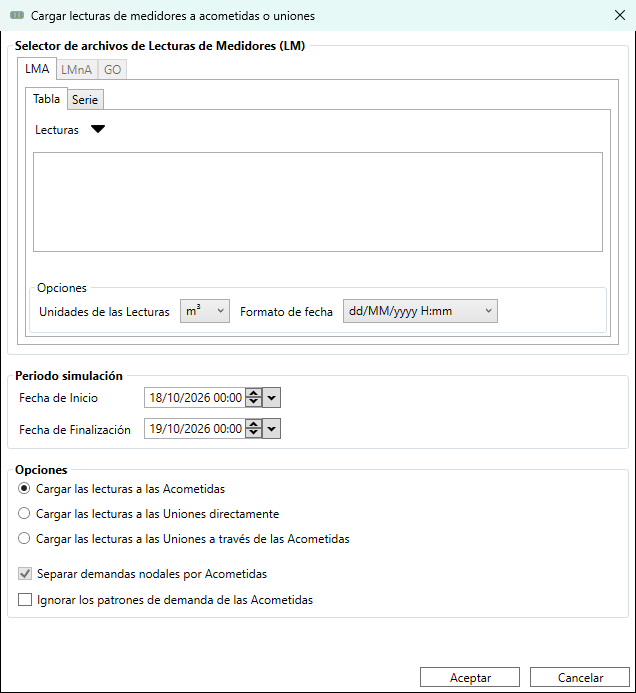

# Sensores y Medidores

Los medidores y sensores del Digital Twin son elementos que registran magnitudes físicas en puntos concretos de la red. QGISRed los almacena en la capa complementaria `Meters` y los usa para cargar datos de campo y compararlos con los resultados de la simulación.

---

## Add meter (desplegable)

**Barra Gemelo Digital → Añadir medidor**

Coloca un medidor o sensor sobre una tubería haciendo clic en el punto de instalación. El desplegable del botón permite elegir el tipo antes de colocarlo; el último tipo usado queda como acción por defecto del botón.

<figure><figcaption>
Desplegable de tipos de medidor en la barra Digital Twin
</figcaption></figure>
*Desplegable Add meter: los 11 tipos de medidor disponibles.*

### Tipos de medidor disponibles

| Tipo | Nombre en la barra | Magnitud registrada |
|------|--------------------|---------------------|
| **Automatic meter** | Add automatic meter | Tipo determinado automáticamente por contexto |
| **Manómetro** | Add manometer | Presión (m.c.a.) |
| **Caudalímetro** | Add flowmeter | Caudal (l/s o unidad configurada) |
| **Contador** | Add countermeter | Volumen acumulado (contador de agua) |
| **Level sensor** | Add level sensor | Nivel de lámina libre en depósito |
| **Differential manometer** | Add differential manometer | Diferencia de presión entre dos puntos |
| **Quality sensor** | Add quality sensor | Concentración de cloro u otro parámetro de calidad |
| **Energy sensor** | Add energy sensor | Potencia o energía consumida (grupos de bombeo) |
| **Status sensor** | Add status sensor | Estado operacional de una tubería o válvula |
| **Valve opening** | Add valve opening | Grado de apertura de una válvula reguladora |
| **Tacómetro** | Add tachometer | Velocidad de giro de una bomba (rpm) |

### Proceso

1. Elige el tipo de medidor en el desplegable.
2. Haz clic sobre la tubería en el punto de instalación.
3. QGISRed llama a `GISRed.AddMeter` con el tipo seleccionado y actualiza la capa `Meters`.

---

## Load meter readings…

**Barra Gemelo Digital → Cargar lecturas de medidor…**

Importa lecturas de contadores inteligentes (smart metering) y las asocia a las acometidas del proyecto. Las lecturas enriquecen las demandas del modelo con datos reales de consumo en lugar de demandas estimadas.

<figure><figcaption>
Diálogo de carga de lecturas de contadores, en su estado por defecto
</figcaption></figure>

### Formatos de importación soportados

| Formato | Estructura del archivo |
|---------|------------------------|
| **Tabla** | Primera fila: cabecera con `Time; Id1; Id2; …`. Columnas: un contador por columna. |
| **Serie** | Una fila por registro: `Id; Time; Demand`. Todos los contadores en el mismo archivo. |

Los separadores de campo se detectan automáticamente del sistema regional. El campo `Time` acepta tanto marcas de tiempo absolutas como offset en horas desde el inicio de la simulación.

> El diálogo también tiene pestañas para otros formatos de lectura (por horas/por días/periódicas, y un formato de facturación GO) — están deshabilitadas en la versión actual, reservadas para una futura ampliación.

### Dónde se cargan las lecturas

Un grupo de opciones (radio buttons) decide qué elemento del modelo recibe las lecturas importadas:

| Opción | Resultado |
|--------|-----------|
| **Cargar las lecturas a las Acometidas** | Las lecturas se asocian a la propia capa `ServiceConnections`, sin tocar los nudos del modelo EPANET. |
| **Cargar las lecturas a las Uniones directamente** | Las lecturas se asignan directamente al nudo (`Junction`) más próximo, ignorando la acometida intermedia. |
| **Cargar las lecturas a las Uniones a través de las Acometidas** | Las lecturas se asignan al nudo siguiendo la cadena acometida → nudo, agregando varias acometidas sobre el mismo nudo si comparten conexión. |

---

## Establecer estado inicial de tuberías desde válvulas de seccionamiento

**Barra Gemelo Digital → Establecer estado inicial de tuberías desde válvulas de seccionamiento**

Propaga el estado de apertura o cierre de las válvulas de corte de la capa `IsolationValves` al campo `InitStatus` de las tuberías que atraviesan cada válvula. Así el modelo EPANET recoge el estado real de la red sin necesidad de modificar manualmente cada tubería.

### Requisito

La capa `IsolationValves.shp` debe existir en el directorio del proyecto. Si no existe, la herramienta muestra un aviso y no realiza ningún cambio.

### Cuándo usarla

- Antes de simular un escenario operacional concreto (por ejemplo, con un sector cerrado por mantenimiento).
- Después de actualizar el estado de varias válvulas de corte en el mapa y antes de ejecutar **Ejecutar modelo**.

> Esta operación sí modifica el modelo EPANET (campo `InitStatus` de `Pipes`). Para volver al estado original, usa **Scenario builder** (barra Tools) si habías guardado el escenario base antes de la operación.

---

## Load field data…

**Barra Gemelo Digital → Cargar datos de campo…**

Importa datos de campo procedentes de sistemas SCADA o registradores de datos y los asocia a los medidores de la capa `Meters`. Los datos cargados quedan vinculados a cada sensor para su comparación posterior con los resultados de la simulación.

El diálogo permite seleccionar el archivo de datos y configurar el formato de fecha/hora y el separador de campos. QGISRed llama a `GISRed.LoadScada` y actualiza los registros de la capa `Meters` con las series temporales importadas.

### Uso típico

1. Exporta los datos de los sensores de campo desde el SCADA a un archivo CSV o DAT.
2. Ejecuta **Load field data** y selecciona el archivo.
3. Ejecuta la simulación (**Ejecutar modelo**).
4. Compara visualmente en el **Curvas de evolución** dock los valores medidos (campo) y calculados (simulación) para cada sensor.
