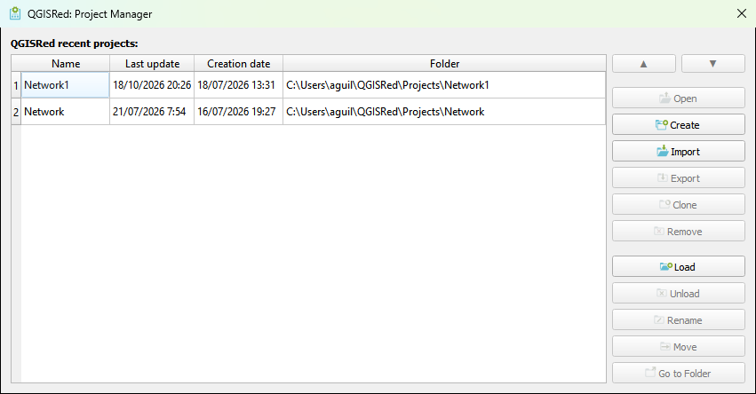
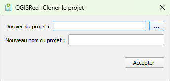

# Chef de projet

**Barre Générale → Gestionnaire de projet** (ou depuis le menu QGISRed → Général → Gestionnaire de projet)

Le Gestionnaire de Projet est la fenêtre d'administration centrale de QGISRed. Permet d'accéder à tous les projets connus sans avoir à se rappeler où ils sont stockés.

<figure><figcaption>
Fenêtre du gestionnaire de projet QGISRed
</figcaption></figure>
*Fenêtre Gestionnaire de projets : liste des projets récents et des opérations disponibles.*

---

## Liste des projets récents

La fenêtre affiche tous les projets qui ont déjà été ouverts sur cet ordinateur. Pour chaque projet, le **nom du réseau** et le **chemin du dossier** sont affichés.

- **Double-cliquez** sur n'importe quel projet → l'ouvre directement.
- S'il existe un projet ouvert avec des modifications non enregistrées, QGISRed demandera une confirmation avant de le fermer.

> 📝 Si le fichier `.qgz`/`.qgs` enregistré pour le projet n'existe plus à l'emplacement attendu (par exemple, après avoir déplacé le dossier à la main hors de QGISRed), l'avertissement _"We cannot find the QGIS project file. Do you want to find this file manually?"_ apparaît. Répondre **Yes** permet de le localiser avec un explorateur de fichiers ; répondre **No**, QGISRed reconstruit le projet directement à partir des groupes enregistrés dans les métadonnées (Inputs, Results, Issues… tous ceux qui existent), pas seulement les couches d'entrée.

## Opérations disponibles

### Charger (Charger)

Permet d'ajouter à la liste un projet qui n'apparaît pas dans l'historique (par exemple, si le projet a été créé sur un autre ordinateur et que le dossier a été copié).

1. Appuyez sur **Charger**.
2. Saisissez le **nom du réseau** (pas d'extension, pas de préfixe de dossier).
3. Sélectionnez le **dossier du projet** avec l'explorateur.
4. QGISRed vérifiera que le fichier `{nombre}_Pipes.shp` existe dans ce dossier avant de l'ouvrir.

### Cloner

Créez une copie complète du projet sous un nom différent. Utile pour créer des variantes sans perdre l'original.

<figure><figcaption>
Dialogue de clonage de projet
</figcaption></figure>

1. Sélectionnez le projet que vous souhaitez cloner.
2. Appuyez sur **Cloner**.
3. Saisissez le nouveau nom du réseau.
4. Choisissez le dossier de destination (il peut s'agir du même dossier si le nom est différent).

> 💡 Le clonage copie tous les fichiers et métadonnées SHP, DBF. Les résultats de simulation ne sont **pas** clonés pour économiser de l'espace.

### Exporter

Conditionne le projet sélectionné dans un ZIP portable (SHP/DBF, `.qgz` et, éventuellement, résultats, problématiques, requêtes, couches auxiliaires et données complémentaires). C'est la seule façon d'exporter un projet : il n'y a plus de bouton équivalent dans la barre **Projet**.

1. Sélectionnez le projet dans la liste (il n'est pas nécessaire de l'ouvrir dans QGIS).
2. Appuyez sur **Exporter**.
3. Complétez la boîte de dialogue d'exportation.

Voir le détail complet du dialogue, ce qui est inclus et ce qui ne l'est pas, dans [Enregistrer, exporter et fermer le projet](../projet-actif/guardar-backup.md#exportar-el-proyecto).

### Renommer

Renomme le réseau et met automatiquement à jour le nom de **tous les fichiers** du projet (SHP, DBF, PRJ, etc.). Il ne s'agit pas d'un simple changement de nom dans la liste : il déplace et renomme les fichiers sur le disque.

1. Sélectionnez le projet.
2. Appuyez sur **Renommer**.
3. La boîte de dialogue propose trois cases indépendantes : **Renommer les données du projet** (renomme les fichiers de données réseau) et **Renommer le fichier de carte du projet** (renomme également le projet QGIS `.qgz`/`.qgs`, s'il existe) — toutes deux cochées par défaut — et **Renommer le dossier du projet :** (renomme également le dossier contenant le projet), décochée par défaut. Au moins une doit être marquée.
4. Saisissez le nouveau nom dans le champ correspondant à chaque case active. Le champ du dossier suggère automatiquement le même nom que le projet tant qu'il n'est pas modifié à la main.

> 📝 **Rename project folder** est désactivée, avec l'avertissement _"Another project in this folder is currently open in QGIS"_, si le dossier contient un autre projet que celui que vous renommez et que cet autre projet est actuellement ouvert dans QGIS — afin de ne pas déplacer ni supprimer des fichiers sur lesquels QGIS maintient un verrou. Les autres projets partageant le dossier continuent d'apparaître normalement dans la liste après le renommage.

> ⚠️ Si le projet est ouvert dans QGIS, fermez-le avant de le renommer pour empêcher QGIS de maintenir des verrous sur les fichiers.

### Supprimer de la liste (Décharger)

Supprime le projet de l'historique récent **sans supprimer les fichiers sur le disque**. Le projet existe toujours dans votre dossier et peut être rajouté avec **Upload**.

### Supprimer du disque (Supprimer)

Supprimez le projet de l'historique **et supprimez tous les fichiers du projet** du disque. Cette opération est irréversible.

> ❗ QGISRed demandera une confirmation avant de supprimer. Assurez-vous d'avoir une sauvegarde si vous devez récupérer le projet à l'avenir.

### Ouvrir le dossier

Ouvrez l'Explorateur Windows directement dans le dossier du projet sélectionné.

---

## Comment QGISRed identifie le projet actif

Lorsque vous ouvrez QGIS avec un projet `.qgz` déjà enregistré, QGISRed reconnaît automatiquement le réseau actif en recherchant les couches chargées dont une correspond à `_Pipes.shp` et possède la propriété interne `qgisred_identifier`.

Si la couche de tuyauterie est chargée mais n'a pas cet identifiant (par exemple, parce qu'elle a été ajoutée manuellement sans passer par QGISRed), le plugin vous avertira avec le message :

> _"Veuillez ouvrir le projet depuis le gestionnaire de projet QGISRed"_

Dans ce cas, fermez les calques et utilisez le Gestionnaire de projet pour ouvrir correctement le projet.
