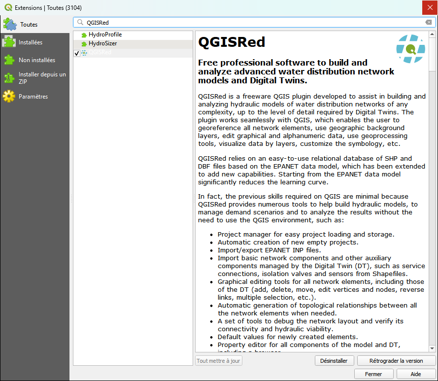

# Installation from Repository

It is the recommended method. Install QGISRed directly from the official QGIS plugin repository and allow you to receive automatic updates.

---

## Step by step

1. Open QGIS.
2. Go to the menu **Plugins → Manage and install plugins…**
3. On the **All** tab, type `QGISRed` in the search box.
4. Select **QGISRed** in the results list.
5. Click **Install Plugin**.

<figure><figcaption>
"All" tab of the add-in manager with QGISRed located after the search.
</figcaption></figure>

When finished, the main QGISRed bar and the **QGISRed** menu will appear in the menu bar in QGIS.

---

## First run

The first time you use any plugin tool, QGISRed detects that the **dependencies** are not installed and displays an installation dialog. See [Dependency management](dependencies.md) for details.

---

## Automatic updates

When starting QGIS, QGISRed checks if a new version is available. If it exists, the QGISRed news window will automatically open informing you of the new version. To update from there:

1. Go to **Plugins → Manage and install plugins…**
2. Open the **Updatable** tab.
3. Select **QGISRed** and click **Update Plugin**.

> You can also activate automatic updating in the **Settings** tab of the plugin manager.

---

## Troubleshooting

**QGISRed does not appear in search results**

The plugin manager needs to have the official QGIS repository configured. Go to **Plugins → Manage and install plugins… → Settings** and verify that the `https://plugins.qgis.org/plugins/plugins.xml` repository is active.

**The "Install Plugin" button is disabled**

It may be because the installed QGIS version is older than 3.28. Update QGIS first.
