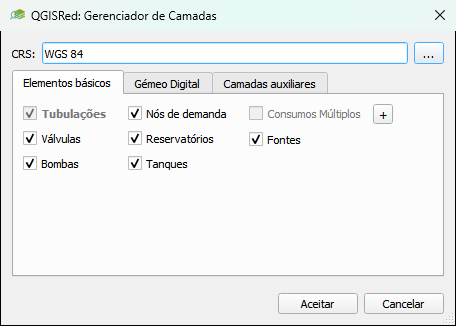
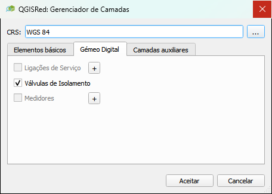
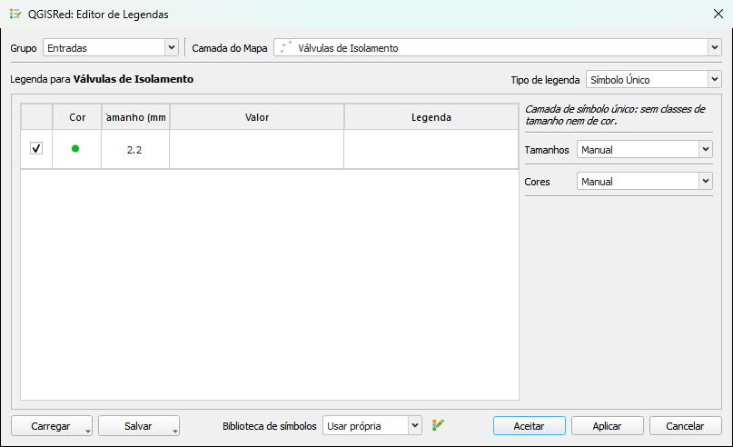

# Gerenciador de camadas e legenda

---

## Gerenciador de camadas

**Barra de projeto → Gerenciador de camadas** (Gerenciador de camadas)

Controla quais camadas do projeto estão ativas no QGIS, permite recriar elementos base ausentes e gerencia as camadas auxiliares do Construtor de consumos nodais. A caixa de diálogo organiza seu conteúdo em três guias: **Elementos básicos**, **Gêmeo digital** e **Camadas auxiliares**.

<figure><figcaption><p>Caixa de diálogo Gerenciador de camadas QGISRed</p></figcaption></figure>
<!-- TODO: Captura desatualizada, caixa de diálogo movida de seções empilhadas para guias (veja commits 12d9ee7 e 11c29ed) -->
*Gerenciador de camadas: lista de todas as camadas do projeto com seu status de carregamento.*

Acima das abas o campo **CRS** está sempre visível, com o sistema de coordenadas do projeto e um botão **...** para alterá-lo.

### Elementos básicos e guias Digital Twin

- **Elementos básicos** reúne os 6 elementos base do EPANET (Tubos, Junções, RNVs, RNFs, Válvulas, Bombas) mais as camadas complementares Demandas Múltiplas e Fontes.
- **Digital Twin** reúne as camadas do gêmeo digital: conexões de serviço, válvulas de isolamento e medidores.

Para cada elemento, a linha mostra uma de duas coisas, dependendo se o arquivo existe ou não no disco:

- **Caixa marcada/desmarcada** → o shapefile já existe; A caixa de seleção decide se a camada está carregada e visível no QGIS. Você pode marcar ou desmarcar qualquer uma sem afetar os dados.
- **Botão "Criar Camada `<Elemento>`"** → o shapefile ainda não existe; o botão o cria vazio (com a estrutura de campo correta) e o abre automaticamente. Depois de criada, a linha agora exibe a caixa.

> ⚠️ Pipes é a exceção: assim que ela é carregada, sua caixa é trancada. É a camada que contém o resto da rede, portanto não pode ser baixado daqui sem primeiro baixar o resto do projeto.

> 💡 Ao pressionar **Aceitar**, a caixa de diálogo atua apenas sobre o que foi alterado: um elemento que já estava marcado e permanece marcado não é fechado e reaberto, portanto preserva seu estilo, sua visibilidade e a seleção que você fez na tela. Alterar o CRS é a exceção — pois reescreve todos os shapefiles, fecha e reabre tudo gerenciado pela caixa de diálogo.

### Recuperar uma camada excluída

Se você acidentalmente excluiu uma camada da legenda QGIS (ou seu arquivo SHP no disco), o Gerenciador de camadas permite que você **recrie-a vazia**: quando você abre a caixa de diálogo, essa camada não mostra mais a caixa marcada, mas sim o botão **Criar `<Elemento>` Camada** descrito acima. Acerte-o e o QGISRed cria o SHP vazio com a estrutura de campo correta e carrega-o no QGIS.

> ⚠️ A recriação cria a camada vazia. Os dados que estavam nele (se o SHP foi apagado do disco) não podem ser recuperados a menos que você tenha uma cópia de backup.

### Aviso de camada desatualizada

Além do ícone de aviso de camada excluída, a legenda do QGIS pode exibir um segundo tipo de ícone de aviso (⚠) em camadas que **existem**, mas cujo conteúdo pode ter se tornado obsoleto.

O QGISRed monitora em segundo plano (verificando a cada 5 segundos) as camadas derivadas penduradas nas pastas do projeto **Issues**, **Queries** e **Results**, cujo nome de arquivo começa com `<Red>_`. Caso o arquivo de entrada mais recente da rede (Tubulações, Junções, etc.) tenha sido modificado após a geração de uma dessas camadas derivadas, essa camada recebe o ícone de aviso com a mensagem:

> "A camada pode estar desatualizada — as entradas mudaram desde a última geração"

- O ícone tem caráter meramente informativo: não possui nenhuma ação associada ao clique nele.
- Para resolver o aviso é necessário **regenerar a camada**, ou seja, reiniciar a análise ou a consulta que a criou (Segmentos Isolados, Setores Hidráulicos, uma consulta de propriedade, etc.).
- As camadas auxiliares do Construtor de consumos nodais (Pontos de Consumo, Links de Demanda, Setores de Consumo) são explicitamente excluídas desta vigilância: são seus próprios dados que você importa ou cria, não algo que o QGISRed recalcula da rede, portanto, a edição de uma entrada não os invalida.

> 💡 Este aviso é diferente do ícone que aparece quando uma camada é excluída (veja "Recuperar uma camada excluída" acima): aqui a camada ainda existe e é carregada, seu conteúdo pode simplesmente não refletir mais o estado atual da rede.

### Aba Camadas auxiliares: Camadas do Construtor de consumos nodais

A aba **Camadas auxiliares** contém o grupo **Demand Builder**, de onde são criadas e gerenciadas as camadas de trabalho vazias utilizadas pela ferramenta de atribuição de demandas aos nós (Construtor de consumos nodais): **Pontos de Consumo**, **Links de Demanda** e **Setores de Consumo**.

<figure><figcaption><p>Aba Auxiliary layers do Gerenciador de Camadas do QGISRed</p></figcaption></figure>

Cada linha da tabela é um **theme** (tema) — você pode ter vários temas do mesmo tipo, por exemplo um `Sectors` diferente para cada campanha de setorização de demanda. A tabela mostra três colunas:

- Caixa de upload (igual às outras abas: marcada = enviada para o QGIS).
- **Tema** — nome do tema, ou "(padrão)" para o qual o próprio Construtor de consumos nodais cria automaticamente.
- **Tipo** — Pontos de Consumo / Ligações de Demanda / Setores de Consumo.

Para criar um novo tópico:

1. Pressione **Criar Tema Auxiliar**.
2. Na caixa de diálogo **Novo tema auxiliar**, escolha o **Tipo** (Pontos de Consumo, Elos de Demanda ou Setores de Consumo) e digite um **Nome**.
3. Pressione **Aceitar**. QGISRed cria o shapefile vazio com os campos correspondentes e adiciona-o já marcado e carregado à tabela.

Para excluir um tema, selecione sua linha e pressione **Excluir Tema Auxiliar**; Será solicitada a confirmação porque a operação também exclui os arquivos do disco.

Ao selecionar um tópico do tipo **Pontos de Consumo**, também aparece um botão **…** (dica "Campos de demanda base") que abre a caixa de diálogo **Campos de demanda base**, onde são gerenciadas as colunas de demanda base do tópico (todos os campos após `DemID` e `Category`):

- A lista mostra um campo por linha, com o nome editável diretamente (clique duplo ou tecla).
- **+** adiciona uma nova linha com um nome livre sugerido (`BaseDem`, `BaseDem2`…); **-** exclui a linha selecionada. O tema precisa sempre de pelo menos um campo de demanda base.
- Ao pressionar **Aceitar**, o QGISRed valida os nomes: eles não podem estar vazios, não podem exceder 10 caracteres (limite de formato DBF), devem começar com uma letra e conter apenas letras, números e sublinhados, e não pode haver dois campos com o mesmo nome (não diferencia maiúsculas de minúsculas). Se algo for inválido, a caixa de diálogo não fecha e mostra o porquê.
- Caso algum campo existente tenha sido removido da lista, antes de aplicar as alterações, é solicitada a confirmação explícita, pois seus valores também são excluídos; renomear um campo, por outro lado, preserva os dados.

> 💡 As camadas que você deixa marcadas nesta tabela são lembradas ao fechar e reabrir o projeto — inclusive projetos que não salvam um `.qgz` — assim como o restante das camadas do projeto.

> Para saber como essas camadas são utilizadas dentro do Construtor de consumos nodais (importar pontos de consumo, gerar links de demanda, agregar por setores...), veja [Demandas e cenários](../ferramentas/demandas-e-cenarios.md).

### Resumo do modelo (Resumo)

**Barra do projeto → Resumo**

Gere um relatório rápido com a quantidade de elementos de cada tipo presentes no projeto:

```
Junctions: 1 243
Pipes: 1 876
Tanks: 3
Reservoirs: 2
Valves: 47
Pumps: 8
```

Útil para verificar se a importação foi concluída ou para documentar o tamanho do modelo.

---

## Editor de legenda

**Barra do projeto → Editor de legendas** (Editor de legendas)

Abre um painel flutuante que permite construir e personalizar a **simbologia** das camadas do projeto sem navegar pelo menu de propriedades da camada QGIS: tipo de legenda, classificação automática, tamanhos, cores, opacidade e borda em camadas de polígono, biblioteca própria de rampas/paletas, estilos de salvar/carregar e regras próprias por tipo de elemento.

<figure><figcaption><p>Painel do Editor de Legenda QGISRed</p></figcaption></figure>
<!-- TODO: captura de tela desatualizada, caixa de diálogo completamente redesenhada e que continuou mudando desde então (bloco de commits [Legends]/[Styles], set-out 2026) -->
*Painel Editor de legendas: estilos predefinidos e personalização de cores e tamanhos.*

### Escolha a camada

No cabeçalho da caixa de diálogo:

- **Grupo** — grupo da árvore de camadas no qual deseja trabalhar (Entradas, Resultados, Consultas e seus subgrupos...).
- **Map Layer** — camada específica dentro desse grupo. Você também pode alterar as camadas selecionando-as diretamente no painel de camadas do QGIS; o editor segue a seleção automaticamente.

### Seletor de variante

Diversas camadas de entrada exibem um menu suspenso adicional que filtra a tabela e as regras de cor/tamanho/opacidade para um subconjunto da camada em vez de todos os seus elementos de uma vez:

| Camada | Menu suspenso | Opções |
|---|---|---|
| Meters | **Meter Type** | "All types" ou um tipo específico de medidor (os diferentes ícones empilhados no símbolo) |
| Junctions | **Demand** | "All", "Outflows (> 0)", "Inflows (< 0)" |
| Sources | **Source Type** | "All types" ou um tipo específico de fonte |
| Service Connections | **Component** | "All", "Line", "Demand circle" |
| Camadas de ligação (Pipes e similares) | **Component** | "All", "Line", "Marker" |
| Nós da árvore de conectividade (Tree) | **Node** | "All", "Junctions", "Root node" |
| Camadas com tipos de elemento próprios | **Element** | "All" + um tipo para cada elemento possível daquela camada |

Enquanto o seletor estiver em "All" (ou não tiver variantes), a cor/tamanho se aplica a todos os elementos de uma vez, exceto se a camada tiver regras de estilo fixas (veja abaixo).

### Tipo e classificação da legenda

O menu suspenso **Tipo de legenda** oferece, dependendo do tipo de camada, entre **Símbolo único**, **Categorizado** e **Graduado**. Somente as opções que fazem sentido para aquela camada aparecem (por exemplo, uma camada de resultados numéricos não oferece Símbolo Único); se a camada for do tipo Single Symbol sem classes, o painel avisa com o texto "Single symbol layer: no size or color classes."

A tabela central lista uma linha por classe, com caixa de seleção de visibilidade, cor, tamanho, valor/intervalo (ou categoria) e rótulo de legenda:

- **Classes** é editável somente quando o modo de classificação admite um número variável de classes (por exemplo, não no modo Manual sobre uma legenda numérica nem em camadas com legenda fixa); nos demais casos aparece em cinza, sem setas, e não pode ser digitado. O botão ao lado, **Add all values** (antes "Classify All"), adiciona uma classe para cada valor único da camada (categórica) ou reclassifica automaticamente o intervalo numérico de acordo com o modo escolhido em **Intervals**.
- O botão **+** ao lado de Classes adiciona uma classe abaixo da seleção com um único clique; a seta ao lado abre um menu com "Add class above the selection" e, em legendas categóricas, 'Add "Other values" class' (uma classe especial que agrupa o restante dos valores não classificados). O botão **-** remove a classe selecionada.
- **Intervals** (`cbMode`) define o método de classificação automática para legendas graduadas: Manual, Equal Interval, Fixed Interval, Quantile (Equal Count), Natural Breaks (Jenks), Standard Deviation e Pretty Breaks. Com **Fixed Interval** aparece o campo **Interval Range** para indicar a largura de cada classe.
- Você pode editar o intervalo de uma classe manualmente **clicando duas vezes em seu valor** (coluna Value) para abrir uma pequena caixa de diálogo com os limites inferior e superior.
- **Up / Down** (setas ao lado da tabela) reordenam manualmente a classe selecionada. O menu suspenso **Class Order** (None / Ascending / Descending), acima da tabela, reordena automaticamente todas as classes por seu valor no momento de aplicar a legenda.

### Tamanhos

O bloco **Sizes** controla o tamanho das classes, sempre em milímetros, exceto a exceção abaixo:

- **Tamanhos** (`cbSizes`): Manual, Igual, Linear, Quadrático, Exponencial ou Proporcional ao Valor.
- **Equal** usa um único campo **Value** para todas as classes.
- Linear/Quadrático/Exponential/Proporcional ao Valor distribua o tamanho entre **Min** e **Max** de acordo com a curva escolhida, com a caixa **Inverter** para trocar qual extremo (menor ou maior valor) recebe o tamanho mínimo.

> 💡 Em camadas com legenda de estado fixa (veja "Regras de estilo específicas" abaixo) ou em uma camada Single Symbol com o seletor de variante em "All", a coluna muda de cabeçalho para **Size (%)**: o valor não é mais um tamanho em mm, mas uma **porcentagem dos tamanhos atuais** — 100% deixa cada elemento com o tamanho que já está desenhado, e o ajuste escala todos de uma vez em vez de fixar um tamanho absoluto por classe.

### Cores

O bloco **Colors** controla a cor de cada classe. O menu suspenso **Colors** (`cbColors`) oferece, além de Manual/Equal/Random, as rampas e paletas da biblioteca agrupadas por tipo:

- **Manual** — cada classe mantém a cor que foi definida manualmente.
- **Equal** — uma única cor (botão de cor próximo ao menu suspenso) para todas as classes.
- **Random** — cores aleatórias diferentes por classe, com o mesmo critério de "cores aleatórias embaralhadas" (shuffle) que o QGIS usa nativamente. O botão de atualização próximo ao menu suspenso (visível apenas neste modo) embaralha novamente as cores sem alterar mais nada.
- **2 colors Ramps / 3 colors Ramps / > 3 colors Ramps** — rampas de cores contínuas, agrupadas pelo número de cores que definem a rampa.
- **Span Palettes** — paleta categórica cujas cores são distribuídas ao longo do intervalo de classes mantendo a primeira e a última.
- **Sequential Palettes** — paleta categórica cujas cores são atribuídas na ordem em que são declaradas na paleta.
- **Labeled Palettes** — paleta categórica em que cada classe recebe a cor cuja etiqueta corresponde ao seu próprio valor.

O próprio editor **recomenda uma opção** de acordo com o tipo de legenda (Span Palettes para legendas numéricas; Labeled Palettes se existir uma paleta rotulada que combine com as categorias da camada, ou Sequential Palettes em qualquer outro caso categórico): essa opção aparece em negrito com o sufixo "(recommended)". As opções sem nenhuma rampa/paleta desse tipo na biblioteca ativa, ou Labeled Palettes sobre uma legenda numérica, aparecem desabilitadas com uma dica explicando o motivo.

A caixa **Invert** troca o sentido da rampa/paleta escolhida.

> 💡 Para a camada do nó da árvore de conectividade (Árvore), a cor da linha não colore todo o símbolo: ela edita apenas a **cor do traço** do círculo externo do nó, deixando os ícones de estrela e elemento com sua própria cor.

### Biblioteca de rampas e paletas

Ao lado do menu suspenso Colors, **Symbol library** permite escolher de onde vêm as rampas e paletas oferecidas por esse menu suspenso:

- **Use default** — a biblioteca que o QGISRed já traz por padrão.
- **Use owner** — sua própria biblioteca editável. Ao selecioná-la aparece o botão **Edit owner**, que abre o gerenciador de estilos nativo do QGIS (Style Manager) sobre essa biblioteca para adicionar, editar ou excluir rampas, paletas e símbolos. As alterações feitas ali se refletem imediatamente no menu suspenso Colors, recalculando até as cores já aplicadas se a rampa ativa tiver mudado.

### Opacidade e borda (camadas de preenchimento)

Em camadas cujo símbolo é um preenchimento de polígono (por exemplo, Setores Hidráulicos e de Demanda), o painel adiciona dois controles que se aplicam **a todas as classes de uma vez**, não classe por classe:

- **Opacity** (0–100%) — opacidade do preenchimento; 100% é sólido, 0% invisível.
- **Border** — modo da borda de cada classe: "No border", "Black", "Fill color" (a borda assume a mesma cor do preenchimento) ou "Darker than the fill"; com qualquer opção exceto "No border" aparece também a largura da borda em mm.

### Regras de estilo específicas por tipo de camada

Os elementos de entrada (Entradas) e algumas camadas de consulta carregam regras de estilo com estados fixos que a cor/tamanho escolhido respeita, em vez de substituir o símbolo inteiro. Por exemplo, Tubos/Válvulas/Bombas mantêm o estado "fechado" em vermelho e Válvulas ativas em laranja, não importa o que aconteça com a cor que você escolher para o restante. Entre as camadas com regras próprias:

- **Demandas Múltiplas**: a cor escolhida colore apenas o ramo "demanda positiva" do símbolo (o marcador interno), assim como nas Junções; a demanda negativa e o restante do símbolo mantêm suas cores fixas.
- **Junctions**: com o seletor **Demand** em "Outflows (> 0)" ou "Inflows (< 0)" você pode classificar e colorir cada grupo de nós separadamente; as demandas negativas sempre mantêm branco nas legendas automáticas por intervalo.
- **Válvulas de Isolamento**: a cor escolhida substitui apenas o estado “aberta, sem perda de pressão”; As cores fechado (vermelho), com perda de carga (âmbar) e não disponível (cinza) são definidas pela própria legenda e não podem ser editadas aqui.
- **Medidores**: A cor e o tamanho são aplicados dependendo do que você selecionou em **Tipo de medidor** — a todos os tipos de medidor de uma vez, ou apenas ao tipo escolhido, sem tocar no restante dos ícones empilhados.
- **Conexões de Serviço**: a cor escolhida é aplicada ao traço da conexão ativa e a uma versão mais clara da mesma cor para seu preenchimento; Os demais estados mantêm sua própria cor.
- **Connect_Links** (resultado da ferramenta Conectividade, dentro de Consultas): diferentemente das anteriores, não possui regras por estado — a cor e o tamanho são aplicados diretamente no símbolo, como em qualquer camada de Símbolo Único.

### Carregar e salvar estilos

Os botões **Carregar** e **Salvar**, na parte inferior da caixa de diálogo, abrem um menu:

**Carregar**
- **Estilo padrão** — recupera o estilo QGISRed padrão para esse tipo de camada.
- **Estilo Global** — carrega um estilo que você salvou anteriormente em nível global (válido para qualquer projeto).
- **Project Style** — carrega um estilo salvo neste projeto.
- **Reverter para Legenda Original** — recupera na caixa de diálogo a legenda que a camada tinha no momento de abrir o editor (sem a necessidade de fechar e reabrir a caixa de diálogo).

**Salvar**
- **To Global...** — salva a legenda atual como um estilo global, reutilizável em qualquer projeto.
- **To Project...** — salva a legenda atual dentro da pasta `layerStyles` deste projeto.

Ao salvar, uma pequena caixa de diálogo permite escolher se deseja salvar a legenda **como vista** ou uma **estratégia** que se regenera automaticamente na próxima vez que você carregá-la (marcando quais partes manter: a estrutura de classe/intervalo, os tamanhos e/ou as cores).

> ⚠️ Tanto **Carregar** quanto **Reverter para legenda original** apenas atualizam a visualização do diálogo. A camada do projeto não muda até que você pressione **Aplicar** ou **Aceitar**.

### Aplicar, Aceitar e Cancelar

Os três botões inferiores têm uma semântica de visualização muito específica:

- **Aplicar** — aplica as alterações mostradas na caixa de diálogo à camada, sem fechar o editor. Útil para ver o resultado na tela enquanto você continua ajustando.
- **Aceitar** — aplica as alterações à camada e fecha a caixa de diálogo (equivalente a Aplicar + Fechar).
- **Cancelar** — fecha a caixa de diálogo e **restaura a camada para a legenda que tinha quando você a selecionou** neste editor, desfazendo também quaisquer alterações que você já tenha aplicado com Aplicar. Caso tenham sido aplicadas alterações, o QGISRed pede confirmação antes de descartá-las.

> 💡 Como Cancelar sempre retorna ao estado inicial (mesmo que você tenha pressionado Aplicar várias vezes enquanto experimentava), é a maneira segura de "recomeçar" com uma camada sem ter que reconstruir sua legenda manualmente.
