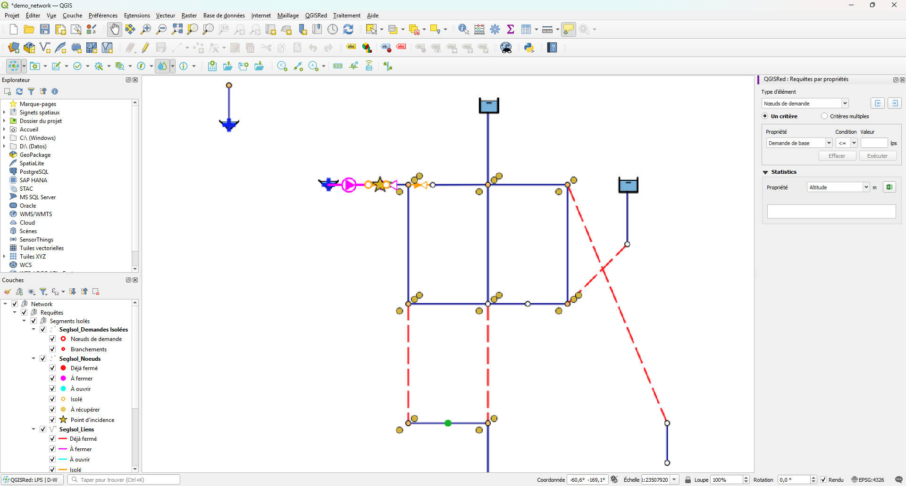

# Property Inquiries

**Queries bar → Queries by properties…**

Opens the **Queries by Properties** panel, a filtering tool that highlights on the map all elements that meet one or more conditions on their attributes. It is the fastest way to find, for example, all pipes with a diameter less than 80 mm, all nodes with pressure below a threshold, or all valves in a closed state.

<figure><figcaption>
Queries by Properties panel with configured conditions and result highlighted in magenta
</figcaption></figure>
*Queries by Properties Panel: conditions configured on pipe attributes. Items that meet the condition are highlighted in magenta on the map.*

---

## Dashboard interface

The panel has an identifying color **purple** (`#7B1FA2`) in its header to distinguish it from the rest of the QGISRed panels. Contains:

- **Element type selector**: Pipes, Junctions, Tanks, Reservoirs, Pumps, Valves
- **Criterion mode**: two options, **One Criterion** (a single active condition) and **Multiple Criteria** (a list of combinable conditions, see below)
- **Conditions area**: one or more rows with field, operator and value
- **Run button**: applies the query and highlights the result
- **Clear Button**: removes the map highlight
- **Statistics panel**: property selector and table with the numeric results of the query (see below)
- **Time label**: When simulation results are loaded, displays the active instant with the prefix "Time:" followed by the bold value in `HH:MM:SS` format. The statistics label for the result is also shown in bold.

---

## Types of conditions

The operator available for each field depends on the data type:

### Numeric fields

| Operator | Meaning |
|----------|-------------|
| `All` | No filter (all values) |
| `>=` | Greater than or equal to |
| `<=` | Less than or equal to |
| `=` | Equals |
| `>` | Greater than |
| `<` | Less than |
| `≠` | Other than |
| `Range` | Between two values ​​(closed interval) |

### List fields (enumerated)

Fields like `Status` that have a finite set of possible values:

| Operator | Meaning |
|----------|-------------|
| `All` | No filter |
| `=` | Equal to selected value |

> ℹ️ For `Type`/`ValveType` on valves, the value selector shows the type's long descriptive name (e.g. "Pressure Reducing" for PRV) instead of the EPANET code.

### Free text fields

Fields like `Tag` or `Id`:

| Operator | Meaning |
|----------|-------------|
| `All` | No filter |
| `=` | Exact same |
| `≠` | Different |
| `ILIKE` | Contains (case-insensitive) |
| `NOT ILIKE` | Does not contain (case-insensitive) |
| `LIKE` | Contains (case sensitive) |
| `NOT LIKE` | Does not contain (case sensitive) |

---

## Process

1. Open **Queries by properties** from the Queries bar.
2. Select the **item type** you want to filter on.
3. Add one or more conditions: choose the field, the operator and write the value.
4. Press **Run**. QGISRed evaluates the query and highlights in **magenta** the elements that meet it — in Multiple Criteria mode, according to the inclusion/exclusion logic explained below.
5. Highlighted items remain visible while the panel is active. Press **Clear** to remove the highlight.

---

## Single or multiple criterion mode

The **One Criterion** radio button limits the panel to a single active condition at a time: changing the field, the operator or the value replaces the previous condition. It is the simplest mode for one-off queries.

The **Multiple Criteria** radio button opens a list of independent conditions that can be combined with each other:

- **Add**: adds the condition configured above to the list, marked as an **inclusion** condition (`+`).
- **Subtract**: adds the condition configured above to the list, marked as an **exclusion** condition (`-`).
- Each row in the list can be **reordered** (up/down arrows), **edited** (double-click or the edit button), **deleted**, or **enabled/disabled** temporarily without deleting it (the "Enable/disable selected criterion" button) to try out combinations without losing the conditions already defined.

Switching from **Multiple Criteria** to **One Criterion** with more than one condition in the list, QGISRed asks for confirmation: only the first one is kept, the rest are discarded.

### Combination logic

Inclusion conditions (`+`) are combined with each other using **OR**: an element is highlighted if it meets **any** of them. Exclusion conditions (`-`) are combined with each other using **AND** and the result is **subtracted** from the previous one. In summary:

> *(any inclusion condition)* **AND NOT** *(all exclusion conditions)*

For example, to find all pipes with a diameter ≥ 300 mm that are **not** cast iron: a `Diameter >= 300` condition marked with **Add**, and a `Material = Cast Iron` condition marked with **Subtract**.

In **One Criterion** mode there is only one condition, so this combination does not apply.

---

## Simulation results

If the project has simulation results loaded, the result fields (pressure, flow, velocity...) also appear in the field selector, allowing you to filter, for example, pipes with a velocity less than 0.5 m/s or nodes with negative pressure.

> ⚠️ **Conditional quality fields.** The result fields `Quality` and `ReactRate` only appear when the project's quality model allows it: `Quality` is hidden with *None* model and `ReactRate` is only visible with *Chemical* model. Static quality fields (`BulkCoeff`, `WallCoeff`, `ReactCoef`, `IniQuality`) are hidden when the quality model is *None*, *Age*, or *Trace*.

---

## Statistics table

The panel calculates numeric statistics on the highlighted elements without needing to export anything. Select the property to calculate in the **Statistics of... for selected Elements** dropdown — any numeric field of the active element type, or one of the result variables if a simulation is loaded — and the table updates automatically.

The columns depend on the type of property:

| Property | Columns |
|---|---|
| Text or list field | **Count** (number of elements) |
| Numeric field | **Count**, **Avg**, **Min**, **Max**, and **Sum** or **StdD** depending on the property (flows and demands show the sum; the rest, the standard deviation) |
| **None** (no property) | only **Count** |

In **One Criterion** mode the table shows a single row with the result of the active condition. In **Multiple Criteria** mode with several conditions enabled, it shows one row per condition (labeled `Cr1`, `Cr2`...) and a final **All** row in yellow with the combined result (the same inclusion/exclusion logic as the map highlight) — this lets you compare how many elements each condition contributes on its own versus the combined total.

## Exporting criteria and statistics

The panel's export buttons (query criteria and statistics table) save by default to the project's `Queries/Queries by properties` subfolder, instead of the root folder.

> 📝 When exporting several combined criteria to text or CSV, each line is numbered as `Cr1:`, `Cr2:`... instead of starting directly with the condition's operator — this way a spreadsheet doesn't mistakenly interpret a criterion that starts with `+` or `-` as a formula.

The statistics CSV includes, before the table of values, header lines with the project, the scenario, the element type, the applied query or queries, and the exported magnitude.

## Usage Notes

- The query does not modify any model data or create new layers: it only changes the temporal symbology.
- Magenta highlighting is visible on any map background.
- When you close the panel, the highlight disappears and the symbology returns to the previous state.

## ID field resolution

The panel uses the same automatic identifier field resolution logic as the Element Explorer (`getIdFieldName(layer)`). Query fields by ID (`PipeID`, `TankID`, etc.) are automatically detected based on the layer type, so queries on the `Id` field work correctly regardless of the actual name of the field in the project shapefile. See [Element Explorer](element-explorer.md) for more details.

The aliases `PumpCurvID`, `BaseDem` and `SourceQual` are automatically recognized as numeric type fields for pumps, demands and sources respectively. The data type of each field (numeric, list or free text) is determined automatically from the element's schema, without the need for manual configuration.
