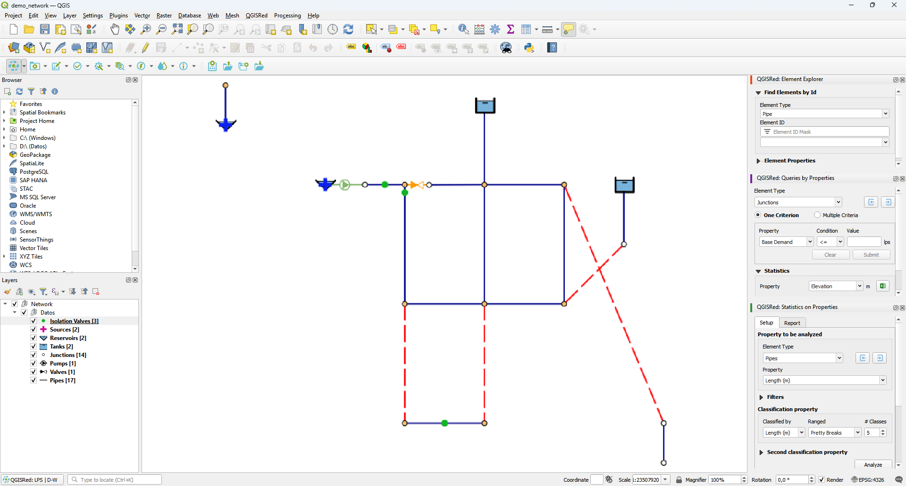

# Element Explorer

Le **Element Explorer** est un panneau flottant (dock) que QGISRed maintient en tant qu'instance unique. Il regroupe deux fonctionnalités connexes dans des sections déroulantes, empilées verticalement (pas dans des onglets côte à côte) : recherche d'éléments par ID et affichage des propriétés de l'élément sélectionné sur la carte.

<figure><figcaption>
Panneau Element Explorer avec les sections Rechercher des éléments par ID et Propriétés des éléments développés
</figcaption></figure>
*Panneau Element Explorer : section "Rechercher des éléments par ID" (en haut) et section "Propriétés des éléments" (en bas).*

Les boutons **Find elements by ID** et **Element properties** de la barre Queries ouvrent ce même panneau et développent la section correspondante — mais **effondrent automatiquement l'autre**, puisqu' une seule section reste développée à la fois par défaut. Si vous avez besoin de voir les deux en même temps (par exemple, pour les captures ou pour comparer les résultats), vous pouvez développer manuellement la section effondrée en cliquant sur son en-tête ; cela ne ferme aucune fonctionnalité.

---

## Section "Rechercher des éléments par ID"

**Barre de requêtes → Rechercher des éléments par ID…**

Localise n'importe quel élément du réseau en écrivant son identifiant et le met en évidence sur la carte.

### Éléments consultables

- Tuyaux, jonctions, demandes, bâches, réservoirs, pompes, vannes, sources

### Processus

1. Activez **Rechercher des éléments par ID**. Le panneau s'ouvre ou est amené vers l'avant.
2. Sélectionnez le type d'élément dans la liste déroulante des calques.
3. Saisissez l'ID dans le champ de texte et appuyez sur **Rechercher** ou Entrée.
4. QGISRed centre la carte sur l'élément et la met en surbrillance. Le résultat apparaît sur le panneau avec un fond jaune clair.

### Recherche multiple

Séparez plusieurs identifiants par une virgule ou un point-virgule pour les mettre tous en surbrillance simultanément.

### Si l'ID n'existe pas

Le panneau affiche un avertissement et la carte ne change pas.

---

## Section "Propriétés des éléments"

**Barre de requêtes → Propriétés des éléments…**

Activez un outil d'identification interactif : en cliquant sur n'importe quel élément de la carte, le tableau de bord affiche tous ses attributs dans cette section.

### Processus

1. Activez les **Propriétés des éléments**. Le curseur passe en mode identification.
2. Cliquez sur n'importe quel élément du réseau.
3. Le panneau affiche les champs de l'élément cliqué. Vous pouvez continuer à cliquer sur d'autres éléments sans désactiver l'outil.

### Informations affichées

Les attributs sont organisés par type d'élément. Pour un **tuyau** typique :

| Champ | Descriptif |
|-------|-------------|
| `Id` | Identifiant unique |
| `Length` | Longueur (m) |
| `Diameter` | Diamètre (mm) |
| `Roughness` | Coefficient de rugosité |
| `Material` | Matériaux |
| `InstallYear` | Année d'installation |
| `Status` | Statut (Ouvert / Fermé / CV) |
| `Tag` | Étiquette gratuite |

Pour les **nœuds** `Elevation`, `Demand`, `Pattern`, `InitQuality`, etc. sont affichés. Chaque type d'élément possède son propre ensemble de champs.

Pour les **vannes**, le champ `Type`/`ValveType` est affiché tel quel avec le code EPANET (PRV, PSV, PBV, FCV, TCV, GPV, CV) — le français ne dispose pas d'abréviation localisée distincte.

Si le projet a des résultats de simulation chargés, le panneau ajoute une section avec les valeurs calculées (pression, débit, vitesse...) pour la période active dans la visionneuse de résultats. L'heure simulée est indiquée par le préfixe **Temps :** suivi de la valeur en gras au format `HH:MM:SS`.

> ⚠️ **Champs de qualité conditionnels.** Le champ `Quality` n'apparaît que lorsque le modèle de qualité du projet n'est pas *Aucun*. Le champ `ReactRate` n'est visible que lorsque le modèle qualité est *Chimique* ; reste masqué pour les modèles *Aucun*, *Age* et *Trace*. Ces champs ne sont affichés que lorsque le modèle qualité du projet les prend en charge.

### Notes d'utilisation

- La désactivation du bouton ramène le curseur au mode de navigation standard de QGIS.
- Si vous cliquez dans une zone sans éléments, le panneau conserve la dernière sélection.
- L'arrière-plan du panneau a une teinte jaune clair pour le différencier du reste des panneaux QGIS.
- Les clics sur les couches n'appartenant pas au projet QGISRed actif (couches d'arrière-plan, couches auxiliaires externes, etc.) sont ignorés : le panneau ne met pas à jour son contenu.

### Résolution du champ ID par couche

QGISRed résout automatiquement le **nom du champ identifiant** de chaque couche réseau à l'aide de la fonction interne `getIdFieldName(layer)`. Cela permet au plugin de détecter correctement l'ID sur les couches avec différentes conventions de dénomination :

| Type de couche | Champ d'identification typique |
|--------------|-----------------|
| Tuyaux | `PipeID` |
| Jonctions | `JunctionID` |
| Réservoirs | `TankID` |
| Bâches | `ReservoirID` |
| Pompes | `PumpID` |
| Vannes | `ValveID` |

Si votre projet utilise des conventions de dénomination personnalisées, la résolution automatique évite les erreurs de recherche ou d'identification. Il n'est pas nécessaire de configurer quoi que ce soit manuellement : le scanner détecte le champ correct lorsqu'il est activé sur n'importe quelle couche du réseau.

### Alias ​​de champs supplémentaires automatiquement reconnus

Le panneau reconnaît automatiquement les alias de champ suivants et les présente avec les étiquettes, unités et décimales correctes sans aucune configuration supplémentaire :

| Alias ​​​​| Descriptif |
|-------|-------------|
| `DemPattID` | Modulation de demande en nœuds ; est supprimé lorsque plusieurs demandes sont actives et sont regroupées correctement |
| `HedPattID` | Modulation de la courbe de hauteur de pompe |
| `QualPattID` | Modulation de qualité dans les polices |
| `NodeID` | Identificateur de nœud dans les couches dérivées |
| `NodeType` | Type de nœud |
| `LinkID` | Identificateur de lien dans les couches dérivées |
| `LinkType` | Type de lien |

> ℹ️ La reconnaissance est automatique : le navigateur détecte le bon alias lorsqu'il est activé sur n'importe quelle couche du réseau, sans qu'il soit nécessaire de configurer quoi que ce soit manuellement.
