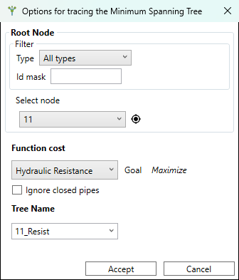
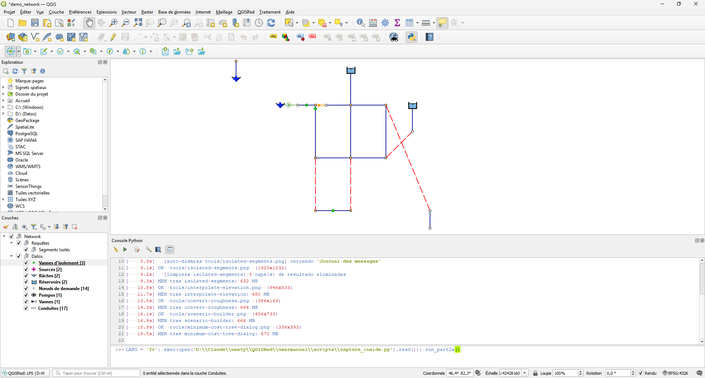

# Demand Sectors and Tree

The last two tools in the Tools bar perform topological analyzes on the network: sectorization by flowmeters and calculation of the minimum cost tree from an origin node.

---

## Obtain demand sectors

**Tools Bar → Obtain demand sectors** (formerly "Demand sector builder…")

It generates a sectorization of the network based on the presence of **flowmeters** (flow meters). Each demand sector is the subnetwork supplied by a single flowmeter, without crossing other flowmeters.

### Difference with hydraulic sectors

| | Hydraulic sectors (Debug Bar) | Demand sectors (Barra Tools) |
|-|-------------------------------------|-----------------------------------|
| **Base** | Presence of Tank or Reservoir | Presence of flowmeters |
| **Question** | Where does the water come from? | What does each flow meter measure? |
| **Classification** | H-Q / H-nQ / nH-Q / nH-nQ | No type, only colored by sector |
| **Use** | Diagnosis before simulating | Water balance by sector |

### Result

The tool generates the `DemandSectors` layer on the map, with each sector in a different color. If the network does not have flowmeters loaded, the result is a single sector that spans the entire network.

No configuration required: launches directly without dialog.

---

## Minimum Cost Tree…

**Tools Bar → Minimum Cost Tree…**

Calculates the **minimum cost spanning tree** of the network from a selected node. It shows the most hydraulically efficient path (least cumulative resistance) from that node to all other reachable points in the network.

### Process

1. Activate the tool.
2. Click on the source node (for example, a supply source or a high water delivery point).
3. QGISRed suggests a name for the tree (by default, the node ID followed by the chosen cost function, e.g. `J5_R`); you can edit it before calculating.
4. QGISRed calculates the tree and generates its own **Tree_&lt;name&gt;** group on the map, with the accumulated distance from the origin labeled on each reach.

<figure><figcaption>
Minimum Cost Tree dialog with source node already selected
</figcaption></figure>

> 📝 You can have **several trees open at once**, each with its own independent name, group and pair of layers (nodes and reaches) — they don't replace each other. The tool's own dialog lists the trees already calculated for the project and lets you delete any of them individually, without affecting the rest.

### Interpretation of the result

<figure><figcaption>
Calculated minimum cost tree, with the accumulated distance labeled in each section
</figcaption></figure>

The resulting tree shows which path the water would follow from the source node if the network were purely branched (no loops). It is useful for:

- Identify pipes that always work in a single direction of flow.
- Detect redundant pipes in the topology (they do not appear in the tree because there is a shorter path).
- Analyze the supply structure in emergency conditions with part of the network closed.
- Plan pressure sectorization schemes.

### Root node ID

In the node layer generated by the tree, the origin (root) node is identified with the value **"ROOT"** in the `NodeType` field. The rest of the nodes have their usual EPANET type (Junction, Tank, Reservoir...). This allows you to create specific symbology rules for the root node directly in QGIS.

The root node also stores, only in its own row, the parameters the tree was generated with: the `CostFn` field indicates the cost function used (hydraulic resistance, diameter or length) and `IgnClosed` whether closed pipes were ignored. Useful for checking how an already generated tree was calculated without having to repeat the process.
